

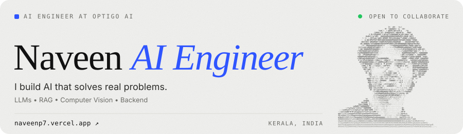

  
  
  
  

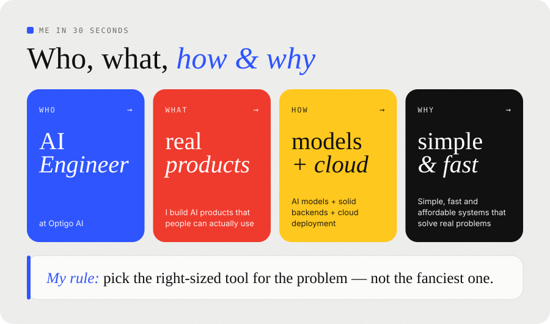

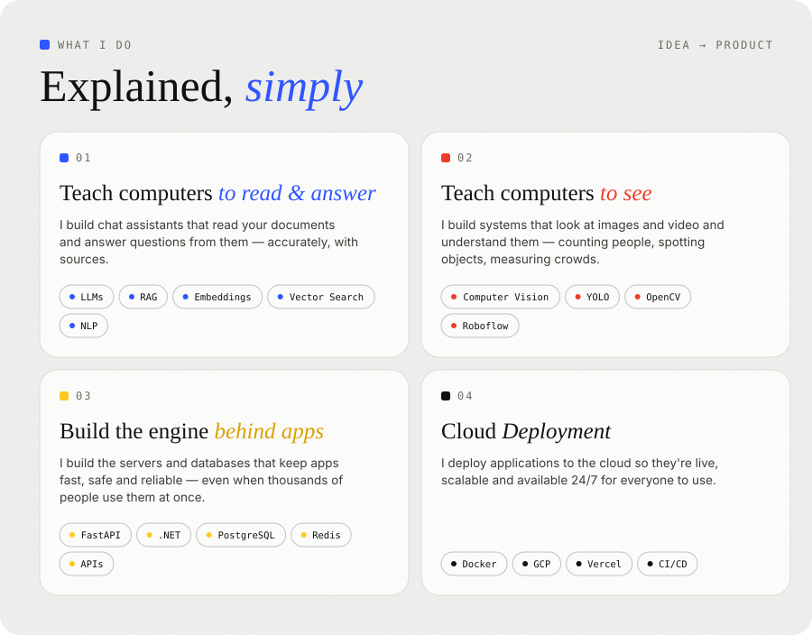

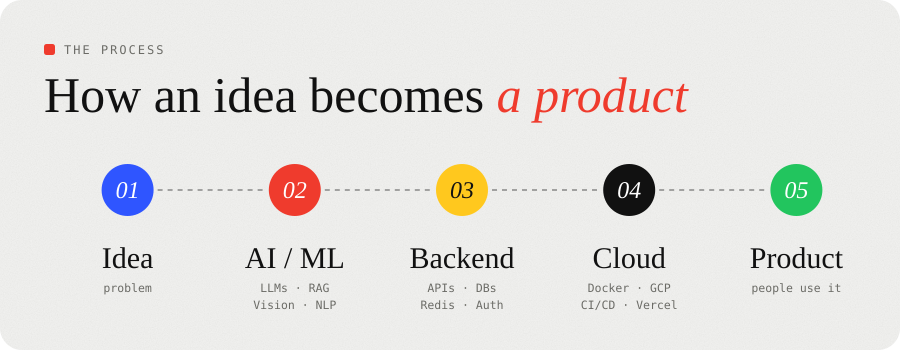

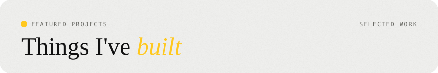


  <a href="https://github.com/Naveenp7/Cost-Efficient-RAG">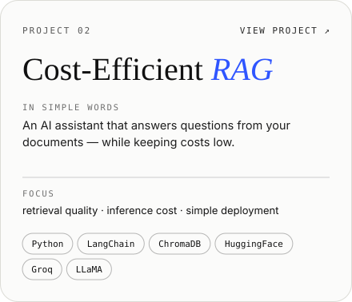</a>
  <a href="https://github.com/Naveenp7/llm-judge">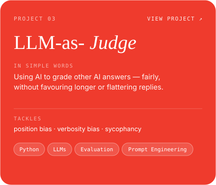</a>

  <a href="https://github.com/Naveenp7/Movie-Seat-Manager">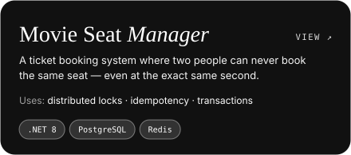</a>
  <a href="https://github.com/Naveenp7/Crowd-Detection">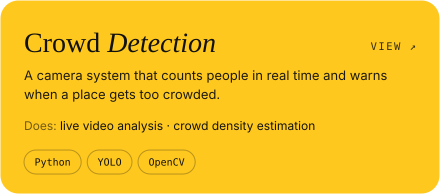</a>

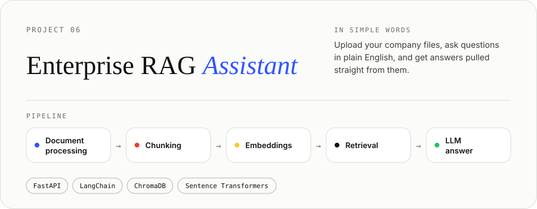

👉 More work in <a href="https://github.com/Naveenp7?tab=repositories">my repositories</a> and on <a href="https://naveenp7.vercel.app">my portfolio</a>

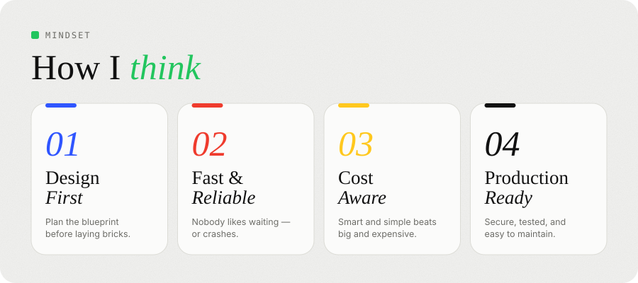

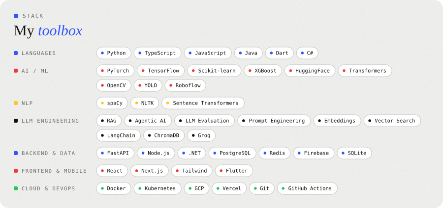

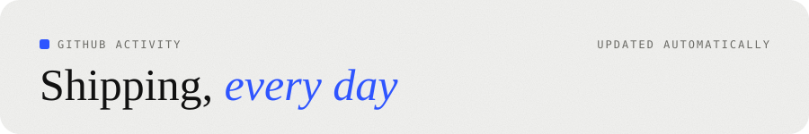

  

  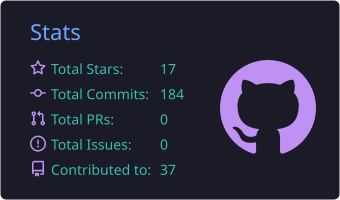
  
  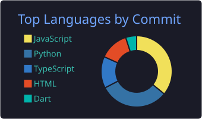

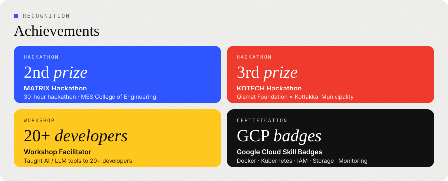

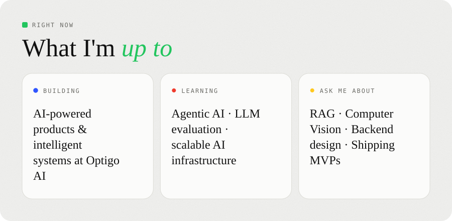

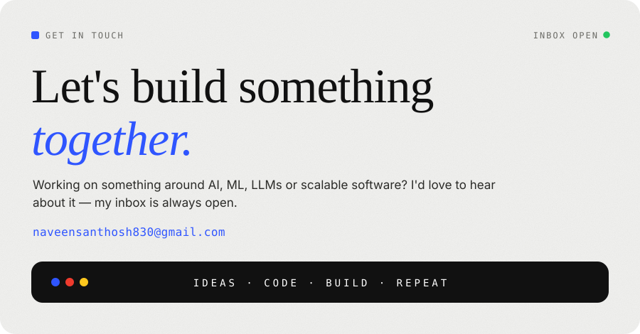

  
  
  

⭐ If you like something here, a star on the repo makes my day!

